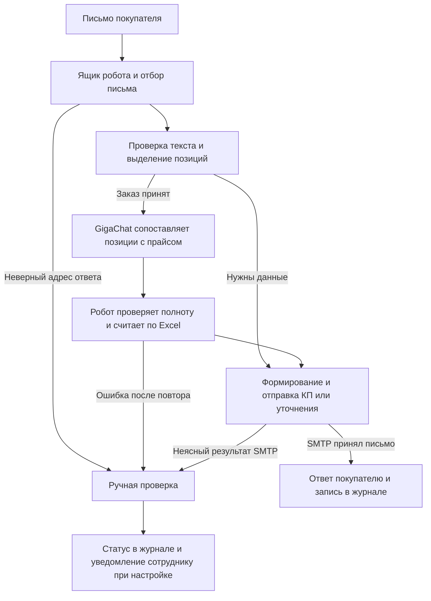

# Демонстрация робота «ОфисСнаб»

## Подготовка

1. Откройте папку `rpa_course` и заполните `.env` рядом с `compose.yaml`. Укажите адрес и пароль приложения **ящика робота** и ключ GigaChat. Запустите панель по [инструкции Docker](README.md#запуск-через-docker).
2. Откройте [панель](http://127.0.0.1:8765/) и нажмите **«Обработать почту»**. На новой базе этот запуск запоминает границу входящих. Отправляйте демонстрационные письма после его завершения.
3. В каждом примере отправляйте с **ящика покупателя** на адрес из `RPA_MAIL_ADDRESS`. Затем нажмите **«Обработать почту»**. Откройте обращение в журнале и проверьте входящие на ящике покупателя.



## Готовые письма

### 1. Точный заказ

**Тема** `Расчёт заказа – демонстрация 1`

```text
Добрый день! Посчитайте, пожалуйста: бумага А4 – 5 упаковок, синие ручки – 20 штук, регистратор А4 75 мм – 3 шт.
```

**Что показать.** В карточке видны три позиции и итог **2 790,00 ₽**. Покупателю приходит КП в исходной переписке. В журнале – статус **«Отправлено»**.

### 2. Неоднозначный товар

**Тема** `Расчёт заказа – демонстрация 2`

```text
Нужны ручки, 20 штук.
```

**Что показать.** В прайсе есть ручки нескольких цветов. Покупателю приходит просьба уточнить товар и прислать полный заказ. В журнале – статус **«Отправлено»** и тип ответа **«Уточнение»**.

### 3. Неподходящая единица

**Тема** `Расчёт заказа – демонстрация 3`

```text
Нужна бумага А4, 500 листов – 5 штук.
```

**Что показать.** Бумага в прайсе указана в упаковках. Робот просит уточнить единицу измерения, сумма не рассчитывается.

### 4. Ручная проверка

Если почтовый клиент поддерживает несколько адресов в `Reply-To`, укажите там оба своих ящика и отправьте с ящика покупателя письмо с темой `Расчёт заказа – демонстрация 4` и текстом из первого примера.

**Что показать.** Робот не может выбрать единственный адрес ответа. В журнале появляется статус **«Требует проверки»**. Сотрудник смотрит причину в карточке, а при заполненном `RPA_NOTIFY_TO` получает сводное уведомление. Покупателю автоматический ответ по такому письму не отправляется.

В конце нажмите **«Обработать почту»** ещё раз. Если новых писем нет, робот покажет ноль новых обращений и ответов.
